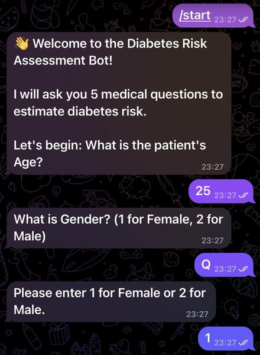
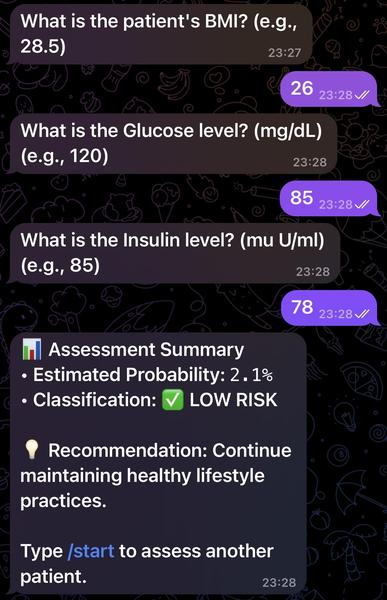

# Diabetes Prediction from Medical Records - TechLabs Aachen ST26

A machine learning pipeline that estimates a person's risk of type 2 diabetes from basic medical values and serves the result through a Telegram chatbot. Four public datasets that measure different features are cleaned, completed with XGBoost models that fill in the missing values, combined into one dataset, and used to train a random forest classifier.

## Highlights

- Combined **4 public datasets (100,899 patients)** that each measure different medical values.
- Trained **3 XGBoost regression models** to fill in missing blood pressure, glucose and insulin values, so that no dataset had to be discarded.
- Built a **random forest classifier** with ROC-AUC 0.988 and a recall of 94% for diabetic patients on a held-out test set.
- Deployed the model in a **Telegram chatbot**: users enter their values and receive a diabetes risk percentage.

## Demo

 

*Example conversation with fictional values.*

## How It Works

```
original_datasets → cleaning → gap filling → combining → prediction model → Telegram bot
```

1. **Cleaning:** each of the four datasets is cleaned and standardized with its own script.
2. **Gap filling:** the datasets measure different features, so entire columns are missing in some of them. Three XGBoost regressors estimate the missing glucose, blood pressure and insulin values from the available features.
3. **Combining:** the cleaned and completed datasets are merged into one table (`combined_dataset.csv`).
4. **Prediction:** a random forest classifier (scikit-learn pipeline with imputation, scaling and a class-weighted forest) is trained on the combined data and outputs a diabetes probability for each patient.
5. **Chatbot:** a Telegram bot loads the saved model, asks the user for their values and returns the risk percentage.

## Repository Structure

```
.
├── original_datasets/              # the 4 original datasets (dataset1.csv – dataset4.csv)
├── codes_preprocessing_datasets/   # cleaning scripts (clean_dataset1.py – clean_dataset4.py)
├── cleaned_datasets/               # cleaned datasets, plus dataset2_filled.csv and dataset3_filled.csv
├── codes_filling_datasets/         # XGBoost models for missing values
│   ├── Blood_Pressure_model/       #   training code (.joblib model) and code that applies it
│   ├── Glucose_model/
│   └── Insulin_model/
├── combining_into_1_csv/           # merging code and combined_dataset.csv
└── prediction_model_final/         # random forest training code, saved .joblib model, bot.py (Telegram chatbot)
```

## Data

| Dataset | Source | Patients used |
|---|---|---|
| 1 | Pima Indians Diabetes Database (US National Institute of Diabetes and Digestive and Kidney Diseases) | 768 |
| 2 | Tigga & Garg, BIT Mesra, Ranchi (India) | 952 |
| 3 | Diabetes prediction dataset by Mohammed Mustafa, Kaggle | 99,070 |
| 4 | Tasin et al., samples from a textile factory in Dhaka (Bangladesh) | 109 |

## Results

Evaluation of the random forest on a stratified 20% test set (20,180 patients, 9.4% with diabetes), at a decision threshold of 0.5:

| Metric | Value |
|---|---|
| ROC-AUC | 0.988 |
| PR-AUC | 0.928 |
| Recall (diabetic class) | 0.941 |
| Precision (diabetic class) | 0.633 |
| F1 score (diabetic class) | 0.757 |
| Accuracy | 0.946 |

The model finds 1,704 of the 1,810 diabetic patients in the test set (106 are missed) and raises 986 false alarms among 18,370 healthy patients. Because only about 9% of patients have diabetes, accuracy alone is not a meaningful measure here, so the focus is on recall, precision and the area under the curves.

## Tech Stack

Python · pandas · NumPy · scikit-learn · XGBoost · joblib · matplotlib · python-telegram-bot (Telegram Bot API)

## Getting Started

**Requirements:** Python 3.11 (tested with 3.11.9)

```bash
git clone https://github.com/huyletoanphuc/TechLabs_ST26_Prediction_of_Diabetes_from_Medical_Records.git
cd TechLabs_ST26_Prediction_of_Diabetes_from_Medical_Records
pip install -r requirements.txt
```

### Running the Telegram chatbot

The chatbot needs its own Telegram bot token, which is **not** included in this repository. Create a bot with [@BotFather] in Telegram and copy its token. Then start the bot and paste the token when prompted:

```bash
python prediction_model_final/bot.py
```

## Disclaimer

This project is a screening prototype and not a medical device. The risk percentage is an estimate and does not replace a diagnosis by a doctor.

## Authors

Toan Phuc Huy Le · Tala Chikh Ali · Muhammad Hasnain Ul Manan

## License

This project was created for academic, non-commercial purposes. No license is specified, so all rights are reserved. The datasets are subject to the terms of their original sources.
